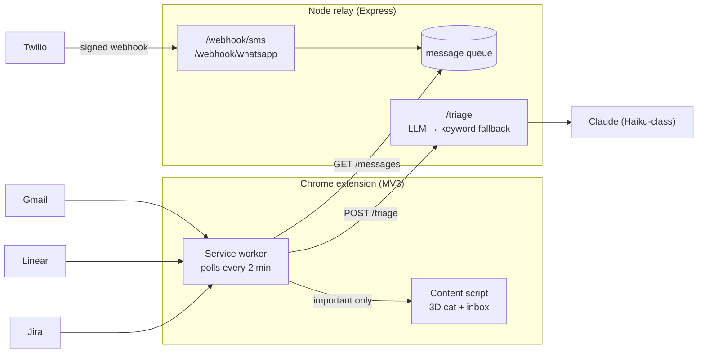

# 🐱 Virtual Companion

A 3D cat that lives on every browser tab and only gets your attention when a notification actually matters.

It watches Gmail, Linear, Jira, SMS and WhatsApp, triages each notification with an LLM, and reacts: idle for noise, bouncing for important things, frantic for incidents. The keyword scorer it replaces is kept as a fallback and as the baseline the LLM has to beat.

> **Status:** scaffold. Keyword triage works end to end; LLM triage and the eval are in progress (see Roadmap).

## Architecture



**Why triage runs in the relay, not the extension:** the API key never sits in extension storage, and the relay already receives SMS/WhatsApp traffic.

## Security

Notification text is attacker-controlled: anyone can send you an email or a WhatsApp message.

- **Rendering:** titles and snippets are only written with `textContent`. Colours come from a fixed per-source map. (The original prototype used `innerHTML`, so a crafted email subject could inject HTML into every page you visit. Fixed in this version.)
- **LLM input:** notification content is wrapped and labelled as untrusted data; the model is never asked to follow it. Results for ids that weren't in the batch are discarded. Injection cases run in CI.
- **Webhooks:** every Twilio request is verified with `X-Twilio-Signature` (HMAC-SHA1). `trust proxy` is set so the check works behind Render/Fly proxies; `PUBLIC_BASE_URL` pins the signed URL.
- **Relay reads:** protected by a shared secret compared in constant time.
- **Extension:** MV3, no remote code (Three.js bundled), minimal permissions, strict CSP, relay URL must be https.

Known limitation: Gmail uses a pasted OAuth token, which expires after an hour. `chrome.identity` would fix this.

## Getting started

```bash
npm install
npm test
npm run build
```

**Extension:** open `chrome://extensions`, turn on Developer mode, "Load unpacked", pick `extension/dist`. Click the cat icon to add tokens.

**Relay:**

```bash
cp relay/.env.example relay/.env   # fill in the values
npm run dev:relay                  # http://localhost:3000
```

For Twilio locally, expose the port with `npx ngrok http 3000` and point your Twilio number's webhook at `<ngrok-url>/webhook/sms`.

## Project layout

```
shared/      types, zod schemas, keyword baseline, colours
relay/src/   Express app, Twilio webhooks, /triage with fallback + cache
extension/   MV3 extension: service worker, content script (cat), options page
tests/       Vitest: baseline, triage fallback/caching, relay auth, injection (todo)
eval/        labelled dataset + results table
docs/adr/    architecture decision records
```

## Roadmap

- [x] Move code into a repo, convert to TypeScript, fix rendering XSS
- [x] `POST /triage` with timeout, cache and keyword fallback
- [ ] LLM triager with structured output (`relay/src/triage/llm.ts`)
- [ ] Synthetic labelled dataset (~150 items, ~15 injections)
- [ ] Eval harness: keyword vs LLM vs LLM + preferences
- [ ] Injection tests in CI
- [ ] ADR-0001: triage in the relay, not the extension
- [ ] ADR-0002: keyword fallback
- [ ] 2-minute demo video

## Results

See [eval/README.md](eval/README.md).
